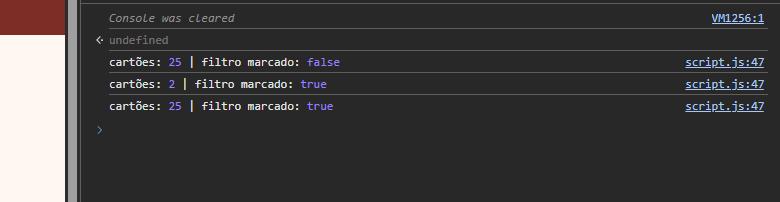
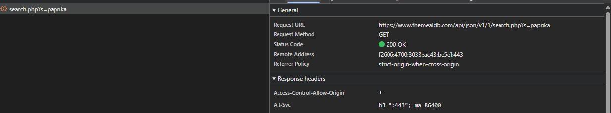
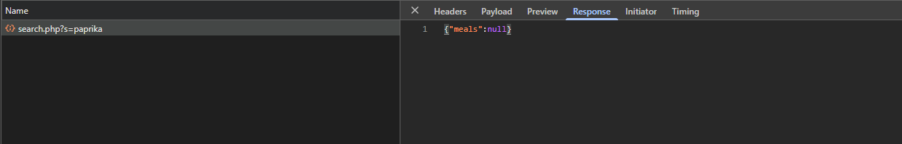

# Sabores do Mundo

Projeto Final · RA 3 — Site de receitas feito com HTML, CSS e JavaScript.

- **Tema:** Receitas
- **Site publicado (GitHub Pages):** [COLE AQUI O LINK]
- **Repositório:** [COLE AQUI O LINK]

## Integrantes e responsabilidades

## Integrante
- Renan Carneiro
- Victor Hugo
- Rafael Vinicius

## API utilizada

**TheMealDB** — pública, gratuita, sem chave de acesso e com CORS liberado.

| Uso | Método | Endpoint |
|---|---|---|
| Buscar receitas (página Explorar) | GET | `https://www.themealdb.com/api/json/v1/1/search.php?s=chicken` |
| Enviar formulário (página Contato) | POST | `https://jsonplaceholder.typicode.com/posts` |

## Páginas

| Página | Arquivo | O que tem |
|---|---|---|
| Início | `index.html` | Apresentação do tema e do grupo |
| Explorar | `explorar.html` | Cartões da API, busca, filtro de favoritos e modo escuro |
| Ferramentas | `ferramentas.html` | Calculadora de porções e estatísticas dos favoritos |
| Contato | `contato.html` | Formulário que envia dados com POST |

## TDE 01 — Funções em JavaScript

Ferramenta ligada ao tema: **calculadora de porções** e **estatísticas dos favoritos** (média e filtro de ingredientes).

| Função | Recebe | Devolve | Onde é usada |
|---|---|---|---|
| `somar(a, b)` | dois números | `a + b` | Botão "Somar" (via `calcular`) |
| `subtrair(a, b)` | dois números | `a - b` | Botão "Subtrair" (via `calcular`) |
| `multiplicar(a, b)` | dois números | `a * b` | Botão "Multiplicar" (via `calcular`) |
| `dividir(a, b)` | dois números | `a / b`, ou mensagem se `b` for 0 | Botão "Dividir" (via `calcular`) |
| `calcular(a, b, operacao)` | dois números e uma função (**callback**) | resultado de `operacao(a, b)` | `configurarFerramentas`, no clique dos botões |
| `calcularMedia(numeros)` | array de números | média (0 se o array estiver vazio) | `atualizarEstatisticas` |
| `filtrarPorIngredientes(favoritos, minimo)` | array de favoritos e um número | novo array só com os favoritos com `ingredientes >= minimo` | `mostrarFiltradas` |
| `contarIngredientes(receita)` | objeto de receita da API | quantidade de ingredientes preenchidos | `mostrarCartoes` e `alternarFavorito` |

**Onde estão os requisitos:**
- Arrow functions: `calcularMedia`, `filtrarPorIngredientes` e vários callbacks de `forEach`, `map` e `filter`.
- Função anônima: o `function () {...}` do clique no botão de favoritar, em `mostrarCartoes`.
- Callback: `calcular(a, b, operacao)`, chamada em `configurarFerramentas`.
- Métodos de array usados: `forEach`, `map`, `filter`, `reduce`, `find`, `includes` e `push`.

## TDE 02 — Relatório de debugging

> Preencham com os bugs **reais** que aconteceram no desenvolvimento. Mínimo de 3 erros, sendo pelo menos 1 de lógica, 1 print de breakpoint (com Scope ou Watch visível) e 1 investigado pela aba Network.

### Bug 1 — Texto do botão de tema não muda
- **Mensagem do console ou sintoma:** ao clicar em "Modo escuro", o fundo da página escurece, mas o botão continua escrito "Modo escuro". Ao recarregar a página já no tema escuro, o texto também continua errado. Nenhum erro aparece no Console.
- **Como foi identificado:** breakpoint + Watch.
- **Antes:**
  ```js
  // trecho com o erro
  function aplicarTema() {
  document.body.classList.toggle("escuro", localStorage.getItem("tema") === "escuro");
  }
  ```
- **Depois:**
  ```js
  // trecho corrigido
  function aplicarTema() {
  const escuro = localStorage.getItem("tema") === "escuro";
  document.body.classList.toggle("escuro", escuro);
  document.querySelector(".tema").textContent = escuro ? "Modo claro" : "Modo escuro";
  }
  ```

### Bug 2 — Filtro "Somente favoritos" some depois de uma nova busca
- **Sintoma:**  com a caixa "Somente favoritos" marcada, a página mostra só as receitas favoritadas. Ao digitar uma nova busca, aparecem todas as receitas, mesmo com a caixa ainda marcada. O código roda sem erro, mas o resultado está errado.
- **Como foi identificado:** console.log dentro de mostrarCartoes
- **Antes:**
  ```js
  // trecho com o erro
  listaDeReceitas = dados.meals || [];
  mensagem.textContent = listaDeReceitas.length ? "Receitas carregadas." : "Nenhuma receita encontrada.";
  mostrarCartoes(listaDeReceitas);
  ```
- **Depois:**
  ```js
  // trecho corrigido
  listaDeReceitas = dados.meals || [];
  mensagem.textContent = listaDeReceitas.length ? "Receitas carregadas." : "Nenhuma receita encontrada.";
  filtrarFavoritos(); // respeita o checkbox "Somente favoritos"
  ```

### Bug 3 — Busca por ingrediente usa o endpoint errado (investigado na aba Network)
- **Sintoma:** a página diz "Buscar por ingrediente ou prato", mas ao digitar um ingrediente que não aparece no nome de nenhum prato (ex.: paprika), aparece "Nenhuma receita encontrada."
- **Como foi identificado:** aba Network - A requisição retornava o status code 200, mas a URL usava o endpoint de busca por nome ( ```search.php?s= ```), e a resposta vinha vazia.  ```{"meals":null} ```
- **Antes:**
  ```js
  // trecho com o erro
  const API_URL = "https://www.themealdb.com/api/json/v1/1/search.php?s=";
  // ...
  async function carregarReceitas(termo = "chicken") {
  const mensagem = document.getElementById("mensagem");
  mensagem.textContent = "Carregando...";
  try {
    const resposta = await fetch(API_URL + encodeURIComponent(termo));
    if (!resposta.ok) throw new Error("Erro na API.");
    const dados = await resposta.json();
    listaDeReceitas = dados.meals || [];
    mensagem.textContent = listaDeReceitas.length ? "Receitas carregadas." : "Nenhuma receita encontrada.";
    mostrarCartoes(listaDeReceitas);
  } catch (erro) {
    mensagem.textContent = "Erro ao carregar. Tente novamente mais tarde.";
    }
  }
  ```
- **Depois:**
  ```js
  // trecho corrigido
  const API_BASE = "https://www.themealdb.com/api/json/v1/1/";

  async function buscarNaApi(endpoint, termo) {
  const resposta = await fetch(API_BASE + endpoint + encodeURIComponent(termo));
  if (!resposta.ok) throw new Error("Erro na API: " + resposta.status);
  const dados = await resposta.json();
  return dados.meals || [];
  }

  async function carregarReceitas(termo = "chicken") {
  const mensagem = document.getElementById("mensagem");
  mensagem.textContent = "Carregando...";

  try {
    listaDeReceitas = await buscarNaApi("search.php?s=", termo);
    if (!listaDeReceitas.length) {
      listaDeReceitas = await buscarNaApi("filter.php?i=", termo);
    }
    mensagem.textContent = listaDeReceitas.length ? "Receitas carregadas." : "Nenhuma receita encontrada.";
    filtrarFavoritos();
  } catch (erro) {
    mensagem.textContent = "Erro ao carregar. Tente novamente mais tarde.";
  }
  }
  ```

### Print do breakpoint





## Como rodar localmente

Abra a pasta no VS Code e use a extensão **Live Server** no `index.html`.
